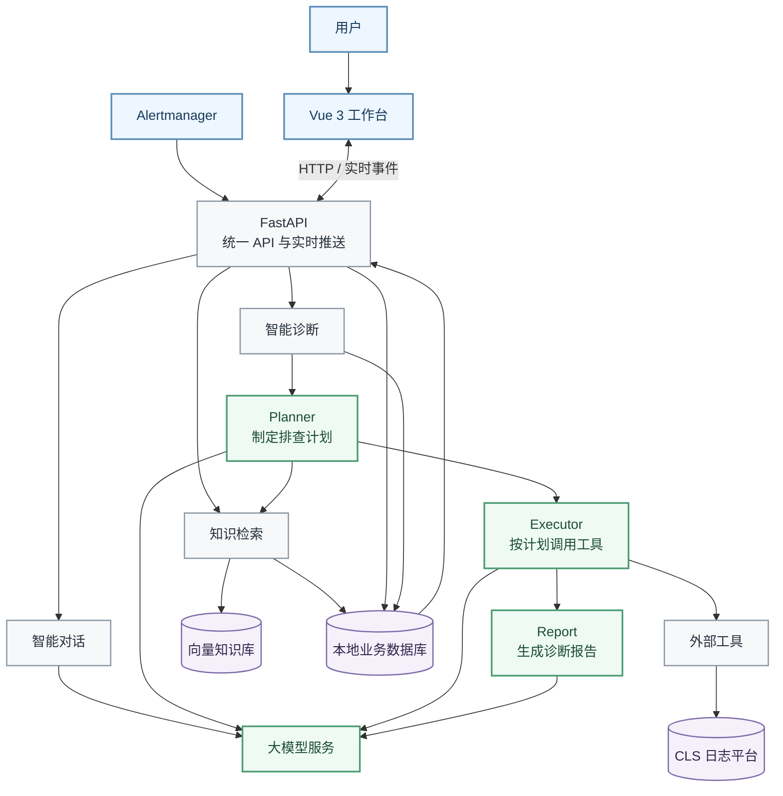

<div align="center">

# OnCall Agent

### 智能运维诊断工作台

把告警、知识、日志和真实工具调用连成一条可追溯的诊断链路

`本地部署` · `真实日志检索` · `证据可追溯` · `任务可恢复`

</div>

---

> **文档版本**：v0.3
>
> **文档定位**：面向业务和管理视角的产品介绍，说明产品实现了什么、如何工作，以及为什么可信。

> **目录**
> [产品概览](#一产品概览) ·
> [业务流程与架构](#二完整业务流程与架构) ·
> [Harness 设计](#三harness-设计) ·
> [关键设计问题](#四关键设计问题)

## 一、产品概览

| 维度 | 说明 |
|---|---|
| 产品定位 | 本地部署的 AIOps 智能运维工作台 |
| 核心目标 | 把告警或用户问题转化为可追溯的诊断结论 |
| 核心输入 | 用户问题、活跃告警、运维知识、真实日志 |
| 核心输出 | 诊断过程、证据链和中文诊断报告 |
| 关键原则 | 模型负责判断，系统负责边界、证据和最终结果 |

OnCall Agent 把告警、用户问题、运维知识、实时日志和诊断报告放在同一个工作空间里。
用户可以描述问题，也可以选择一条活跃告警；系统会检索相关知识、规划排查步骤、调用
真实日志工具、整理证据，最后生成一份可以追溯来源的诊断报告。

产品目前包含三个核心工作区：

| 工作区 | 已实现能力 |
|---|---|
| 智能对话 | 知识问答、工具调用、来源引用、多轮会话 |
| 知识管理 | 文档上传、切片、索引、混合检索、引用追踪 |
| 智能诊断 | 问题/告警输入、计划执行、真实取证、报告、案例沉淀 |

它解决的不是“让大模型多聊几句”，而是三个更实际的问题：

1. 值班人员不必手工翻查大量日志和 SOP；
2. 模型不能只给出看似合理但没有依据的结论；
3. 每一次诊断过程都能回看、追溯和恢复。

产品采用前后端分离架构，支持本地部署。核心业务数据保存在本地数据库中，日志和知识
检索分别接入 CLS 与向量检索服务。

## 二、完整业务流程与架构



### 完整诊断流程

| 阶段 | 系统完成什么 | 用户得到什么 |
|---|---|---|
| 1. 输入 | 接收用户问题、活跃告警，或两者组合 | 一个明确的诊断目标 |
| 2. 建任务 | 保存输入和状态，并在后台持续执行 | 关闭页面也不会中断诊断 |
| 3. 找知识 | 检索相关 SOP 和历史案例 | 可参考的排查经验 |
| 4. 找工具 | 根据用户已启用的连接确认可用能力 | 只使用本次真实可用的只读工具 |
| 5. 做计划 | 结合问题、告警、知识和工具制定步骤 | 清晰、有界的排查计划 |
| 6. 执行 | 按既定计划逐步调用工具 | 每一步执行状态与结果 |
| 7. 取证据 | 整理日志结果、记录来源和调用情况 | 可以追溯的现场证据 |
| 8. 写报告 | 基于真实执行结果生成并校验报告 | 带来源依据的中文诊断报告 |
| 9. 留存 | 保存任务、计划、证据和报告 | 随时可回看的完整诊断记录 |

> **产品分工**
>
> 模型负责理解问题、选择排查思路和组织文字；系统负责权限、工具调用、时间范围、
> 证据校验和最终状态。

---

## 三、Harness 设计

Harness 可以理解为围绕模型搭建的一套运行脚手架：它不替模型做判断，而是为模型提供
必要的信息、工具、执行边界和反馈，把模型能力转化为一条稳定、可运行的业务流程。

### 3.1 信息分配

不同角色只看到完成自己工作所需的信息：

| 角色 | 主要职责 | 获得的信息 |
|---|---|---|
| Planner | 理解问题并制定排查计划 | 用户问题、告警、SOP、可用工具说明 |
| Executor | 按已有计划执行 | 当前步骤、必要上下文、当前工具说明 |
| Report | 依据真实结果生成报告 | 告警、执行结果和已保存证据 |

这样既能减少无关信息干扰，也能降低模型把背景内容误当成事实的风险。

### 3.2 任务状态

智能诊断按任务处理，不依赖聊天记忆。每次诊断都是独立任务，以下内容会持久保存：

- 用户输入和告警快照；
- 当前诊断计划和执行进度；
- 每一步的状态和结果；
- 工具调用记录和证据；
- 最终报告和结论来源。

因此页面刷新、连接中断或后台服务重启后，任务仍然可以继续或恢复。

### 3.3 工具能力

系统不会把工具写死在提示词里，而是根据用户当前启用的外部连接动态确认可用能力。

- 只有只读工具可以进入智能诊断；
- 模型只能使用本轮真实可用的工具；
- 查询区域、日志主题、时间范围等关键参数由系统提供；
- 每次工具调用都会记录状态和安全摘要；
- 参数错误、临时故障和不可恢复错误采用不同的恢复策略。

### 3.4 安全边界

关键规则由系统执行，而不是依赖模型自觉遵守：

- 用户只能访问自己的任务、知识、证据和报告；
- 智能诊断不会执行有副作用的工具；
- 模型不能修改日志区域、主题和查询时间范围；
- 密码、密钥和敏感参数不会出现在普通日志或用户界面；
- 报告只能引用本次任务中真实存在的证据；
- 没有足够证据时，必须明确提示结论不可信。

### 3.5 执行节奏

智能诊断采用“先规划、后执行”的方式。Planner 生成一份固定计划，Executor 按计划
逐步执行，不会在运行过程中让模型反复修改计划。

系统为计划规模和执行次数设置上限，同时后台任务有超时、取消和恢复机制。因此任务不会
因为模型不断提出“再查一次”而无限运行。

### 3.6 过程可视

用户可以查看的不只是最终报告，还包括：

- 当前诊断处于哪个阶段；
- 计划执行了哪些步骤；
- 调用了哪些工具以及是否成功；
- 使用了哪些日志和知识证据；
- 报告中的结论分别引用了哪些证据；
- 任务最终成功、证据不足还是执行失败。

这使诊断过程可以复核，而不是只得到一个无法解释的结论。

---

## 四、关键设计问题

### 4.1 怎么才算诊断成功？

“系统生成了报告”不等于诊断成功。当前产品要求同时满足两个条件：

1. 本次诊断取得了真实运行证据，至少命中一条相关日志；
2. 报告基于这些真实证据生成，并通过完整性和来源校验。

> [!IMPORTANT]
> **诊断成功 = 真实日志证据 + 报告来源校验通过。**

不同信息在诊断中的作用如下：

| 信息 | 作用 | 能否单独证明诊断成功 |
|---|---|---|
| 用户 query | 说明用户想排查什么 | 否 |
| 告警 | 提供问题对象、症状和时间范围 | 否 |
| SOP / 历史案例 | 提供排查经验和处理建议 | 否，只能作为辅助 |
| 查询语句 | 帮助系统检索日志 | 否，只是中间结果 |
| 真实日志命中 | 证明本次查询实际找到了相关现场信息 | 是 |

因此，只有 SOP 或历史案例时，可以形成诊断假设和排查建议，但不能证明本次故障已经发生
或根因已经确认。系统会如实标记为“证据不足”，不会把经验判断包装成确定性结论。

### 4.2 计划执行成功，但报告失败怎么办？

Planner 不生成最终报告。Planner 只负责制定计划，Executor 负责取得真实结果，Report
才负责组织最终报告。因此，工具执行成功只是诊断成功的前提，不是最终结论。

系统通过多层校验避免“执行成功但报告不可信”：

- 报告只能使用本次任务的真实结果，不能重新编造事实；
- 报告必须符合固定结构；
- 每条关键结论必须能够追溯到真实证据；
- 任务是否可信由系统根据证据判断，不由报告自己声明；
- 报告生成失败时，系统会给出诚实的说明，并把任务标记为失败；
- “报告生成失败”和“证据不足”会分别提示，便于用户判断问题出在哪里。

> [!IMPORTANT]
> **宁可明确失败，也不把一份无法证明的报告展示成成功结果。**

### 4.3 任务什么时候结束？

任务结束由系统控制，不由模型自行宣布：

- 计划最多包含 8 个步骤；
- 每个步骤最多尝试两次；
- 某一步失败后仍继续处理剩余步骤，保证最终执行结果完整；
- 所有步骤处理完后进入报告阶段；
- 报告生成后任务结束；
- 后台任务还设有总超时和取消机制。

因为采用“固定计划 + 有界执行”，当前产品不存在由模型驱动的无限观察、重规划和再次行动
循环。任务一定会结束，但“结束”不等于“成功”；只有证据和报告都满足要求，诊断才算成功。

### 4.4 持久化任务是怎么做的？

智能诊断不是一次普通的同步请求，而是一个可能持续几分钟的后台任务。用户提交后，系统会
立即创建一条诊断任务记录，并返回任务编号；后续的计划、执行、取证和报告都在后台继续。

持久化任务主要完成四件事：

1. **保存输入**：记录用户问题、告警和相关上下文；
2. **保存进度**：记录当前计划、执行步骤、每步状态和结果；
3. **保存结果**：保存工具调用记录、证据、报告和结论来源；
4. **支持恢复**：页面关闭、连接中断或服务重启后，任务仍可继续或恢复。

这样设计主要有三个原因：

- 诊断过程涉及多次模型调用和日志查询，耗时不固定，不适合一直占用一个页面请求；
- 用户可能关闭页面或网络中断，但任务不能因此丢失；
- 运维场景需要事后审计，必须能回答“当时用了什么输入、执行了什么、依据是什么”。

后台任务还提供超时、重试、取消和状态查询能力，用户可以随时回来查看历史任务。任务状态
会明确区分执行中、成功、失败、证据不足和已取消，避免只靠页面是否还开着来判断结果。

### 4.5 产品的核心判断

```text
模型负责判断
系统负责边界、证据和最终结果
```

工具选择、排查顺序和文字表达可以交给模型；权限、数据归属、可用工具、日志时间范围、
证据真实性、任务状态和失败处理必须由系统保证。

这也是 OnCall Agent 最核心的产品价值：不是简单接入一个大模型，而是把模型能力转化为
一个可解释、可追溯、可恢复的运维诊断流程。
